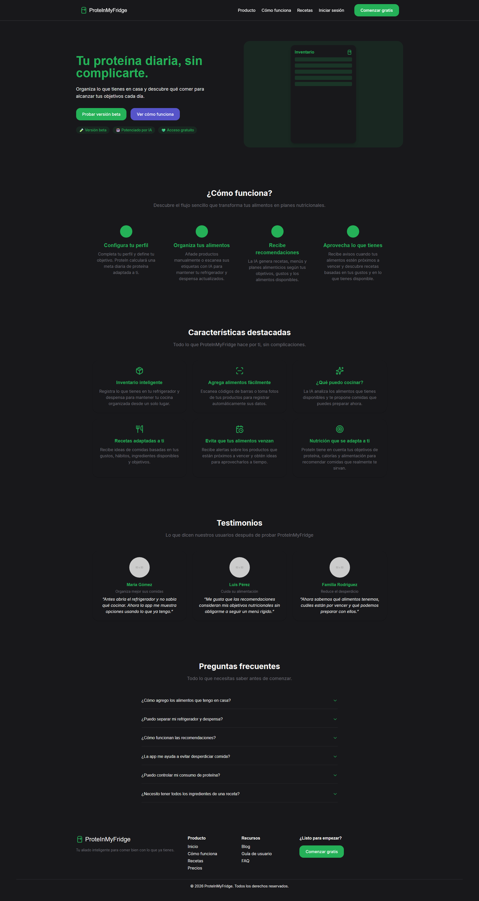

[Leer en español](README_es.md)

# ProteInMyFridge (ProteInApp)

Responsive landing page and UI prototype for a planned web app that helps users organize the food in their fridge and pantry and reach a daily protein goal.

> **Project status:** UI prototype. Only the landing page is implemented. The app features described on the page are planned and not yet functional.

**Live demo:** https://marmopache.github.io/ProteInApp/

## Screenshot



## What is implemented

| Feature                                                                                     | Status         |
| ------------------------------------------------------------------------------------------- | -------------- |
| Responsive landing page (Hero, How it works, Features, FAQ, Footer)                         | ✅ Implemented |
| Reusable component architecture with content separated from UI (`src/data/homeContent.tsx`) | ✅ Implemented |
| Automatic deployment to GitHub Pages (GitHub Actions)                                       | ✅ Implemented |
| Food inventory (fridge and pantry)                                                          | 🗓 Planned     |
| Daily protein goal and progress tracking                                                    | 🗓 Planned     |
| Expiration date alerts                                                                      | 🗓 Planned     |
| Barcode scanning and AI product recognition                                                 | 🗓 Planned     |
| AI-based recipe and meal recommendations                                                    | 🗓 Planned     |
| User accounts and login                                                                     | 🗓 Planned     |

## Tech Stack

| Layer      | Technology                    |
| ---------- | ----------------------------- |
| Framework  | React 18                      |
| Language   | TypeScript                    |
| Build tool | Vite                          |
| Styling    | Tailwind CSS                  |
| Icons      | Lucide React                  |
| State      | React Hooks                   |
| Deployment | GitHub Pages + GitHub Actions |

## Project Structure

```
ProteInApp/
├── .github/workflows/   # GitHub Pages deployment
├── public/
├── src/
│   ├── components/      # Reusable UI components
│   └── data/
│       └── homeContent.tsx   # Landing page content
├── index.html
├── package.json
├── tailwind.config.cjs
├── vite.config.ts
└── tsconfig.json
```

## Getting Started

Requirements: Node.js (LTS) and npm.

```bash
git clone https://github.com/Marmopache/ProteInApp.git
cd ProteInApp
npm install
npm run dev
```

Then open the local address shown in the terminal (usually http://localhost:5173/).

To create a production build:

```bash
npm run build
```

## What I Practiced

- Building a responsive interface with React, TypeScript, and Tailwind CSS
- Structuring a project with reusable components and centralized content
- Using Vite as a build tool
- Deploying a static site with GitHub Pages and GitHub Actions

## Notes

The testimonials on the landing page are illustrative examples and do not belong to real users.

## License

Copyright (c) 2026 Gabriela Alvarado Rosales. All rights reserved.
This source code is publicly visible for demonstration and portfolio purposes only. No permission is granted to copy, modify, distribute, sublicense, or use it commercially without prior written authorization from the author.

## Author

**Gabriela Alvarado Rosales**, Junior Full-Stack Developer (Python, Django, React)
GitHub: [@Marmopache](https://github.com/Marmopache)
